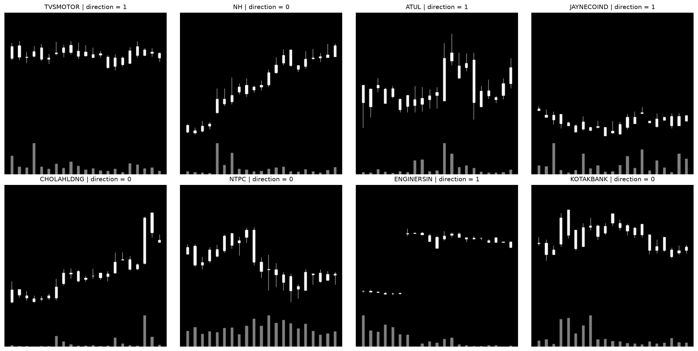

# CNN Trading Model

Explore FinVision-21 candlestick charts and set up a pretrained ResNet-18 for
stock direction classification. The project currently includes dataset inspection
and a model setup check; no training is performed.

## Setup

Run these commands from the repository root:

```bash
python3 -m venv .venv
source .venv/bin/activate
python -m pip install torch torchvision pillow matplotlib
```

The local Python environment and full dataset are excluded from Git.

## Dataset

Download [FinVision-21 from Kaggle](https://www.kaggle.com/datasets/dragonite234/stockdata-nse)
and unzip it into `data/stockdataset_384/`:

```text
data/stockdataset_384/
├── images/
│   ├── candles/
│   ├── trend/
│   ├── momentum/
│   └── volatility/
└── labels/
```

Each JSON label is shared by all four chart types and matches its image by filename,
e.g. `OILCOUNTUB_000840.png` and `OILCOUNTUB_000840.json`. Labels contain `symbol`,
`index`, `window` (21 days), `current_close`, `future_close`, `delta`, normalized
future values, and `direction`.

The target is `direction = 1` when `future_close > current_close` (up), otherwise
`0` (down or unchanged).

### Inspect charts and labels

```bash
python model/load_charts.py
```

To use a different dataset location:

```bash
python model/load_charts.py "path/to/stockdataset_384"
```

The script matches images to labels, checks a random sample of 10,000 labels, and
displays eight random valid charts with their stock symbols and direction labels.
It saves the preview to `model/example_charts.png`. The run can take a few minutes;
close the chart window to finish.



### Findings

- All 226,068 candle images have matching labels. Image validation found 216,972
  valid images and 9,096 broken images (about 4%). The broken files are 9-byte
  files in the Kaggle dataset and must be skipped during training.
- Across four runs of 10,000 sampled labels, every direction matched the price
  comparison above.
- Sampled labels are approximately balanced between the two classes, giving an
  accuracy baseline of about 50%.
- A sample of 10,000 labels included about 1,340 distinct stocks.
- Charts use white candles on black backgrounds with gray volume bars; up and
  down days are not distinguished by color.

## ResNet-18 setup check

```bash
python resnet_setup.py
```

The first run downloads pretrained weights. The script replaces ResNet-18's final
layer with a two-class output, applies the weights' preprocessing to the included
`sample_images/CHAMBLFERT_002667.png`, and runs a forward pass. Verified shapes:

- Input: `[1, 3, 224, 224]`
- Output: `[1, 2]`

The final layer is untrained, so its raw scores only verify that the setup works.

## Open questions

- Labels provide a stock-history `index` but no calendar dates. How should the
  chronological train/test split be defined?
- The prediction horizon for `future_close` is unspecified in the labels; the
  ticket says seven days while the roadmap says five. Which should training use?
- Are broken images concentrated in particular stocks, such as 20MICRONS or
  AARVEEDEN? This has not been fully checked.

## Attribution

The unchanged sample image comes from FinVision-21 by Dragonite_234 on Kaggle,
licensed under CC BY-NC 4.0.
