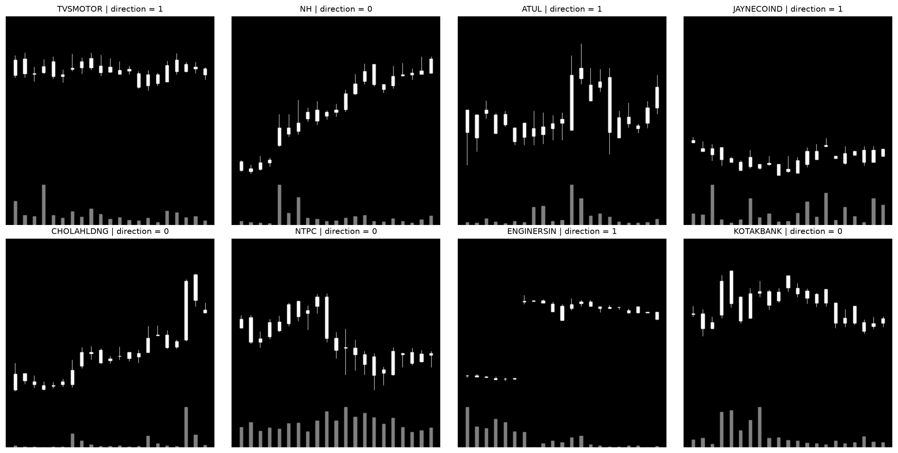

# Task 2: Load and Display Chart Images (Ashley)

## What this does
`load_charts.py` loads the FinVision-21 candlestick images, matches each one to its
JSON label file, checks that the labels are correct, and displays 8 random examples
with their stock symbol and direction label.

## How to run it
1. Install packages: `pip install pillow matplotlib`
2. Download FinVision-21 from Kaggle:
   https://www.kaggle.com/datasets/dragonite234/stockdata-nse
3. Unzip it into a `data` folder in the repo, so the path is
   `data/stockdataset_384/images/candles`. (`data/` is in `.gitignore`, so it
   won't be uploaded.)
4. From the repo folder, run: `python model/load_charts.py`
   - To use a different location: `python model/load_charts.py "path/to/stockdataset_384"`
   - It takes a few minutes. Close the chart window to finish.

## Dataset structure
- `images/` has four folders: `candles`, `trend`, `momentum`, `volatility`
- `labels/` has one JSON file per sample, shared by all four chart types
- Files match by name, e.g. `OILCOUNTUB_000840.png` and `OILCOUNTUB_000840.json`
- Each label has: `symbol`, `index`, `window` (21 days), `current_close`,
  `future_close`, `delta`, normalized future values, and `direction`

## Findings
- **226,068 candle images and 226,068 labels. Every image has a matching label.**
- **`direction` = 1 if `future_close` > `current_close`, otherwise 0.** In a random
  sample of 10,000 labels (run 4 times), every label matched this rule.
- **Labels are balanced: about 50% up, 50% down/flat.** A model needs to beat about
  50% accuracy to be better than guessing.
- **At least about 1,340 different stocks** (counted from a 10,000 sample).
- **About 4% of images are broken: 9,096 candle images are 9-byte empty files** that
  can't be opened. They are also 9 bytes on Kaggle, so this is a problem in the
  dataset itself. Training code needs to skip them.
- **Labels have no calendar dates**, only an `index` (position in the stock's
  history). This matters for the date-based train/test split.
- **Charts are white candles on black with gray volume bars.** Up and down days
  aren't colored differently.

## Example output

## Questions / blockers
- Without calendar dates, how do we split the data chronologically?
- The labels don't say how many days ahead `future_close` is. The ticket says 7 and
  the roadmap says 5. Which is it?
- Broken images may be concentrated in certain stocks (e.g. 20MICRONS, AARVEEDEN).
  Not fully checked yet.